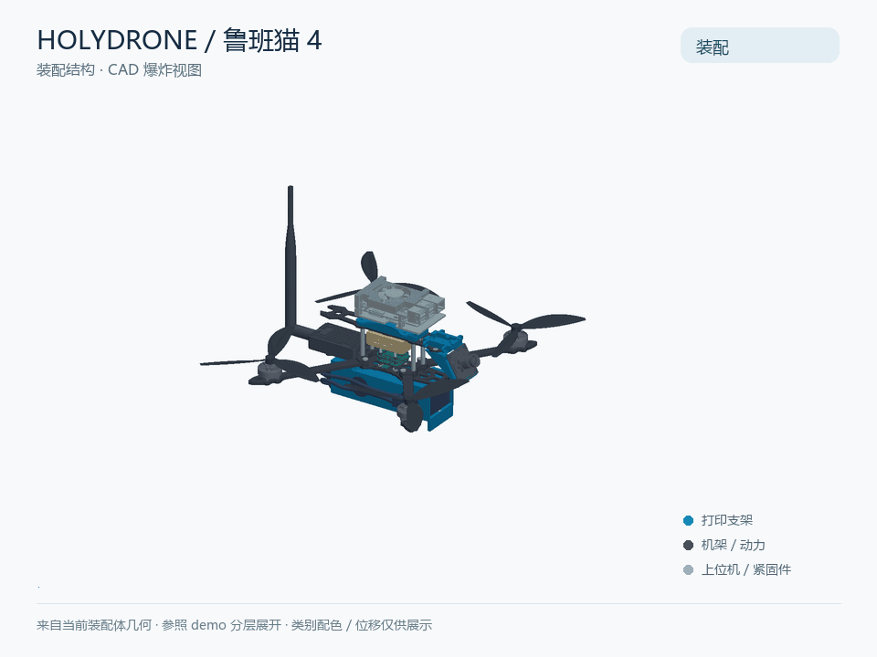

# holydrone

用于无人机结构集成与气球牵引实验的 CAD 仓库，包含四种主装配体、机载模块外形模型、机架板件、改装支架和 3D 打印零件。仓库主要帮助读者查看装配关系、比较上位机安装方案、制作实验附件与打印件。

当前文件以 SolidWorks 装配/零件为主，部分附件提供 STL、STEP 或 CATPart。`Firmware/` 提供 PX4 固件文件，`Params/` 提供两份飞行参数快照；固件与参数的适配机型及实测性能仍需核实。上位机软件、接线图和经过实测确认的整机性能表尚待补充。

## 四种机型与展示

| 主装配体 | 方案 | 当前配置与区别 |
| --- | --- | --- |
| [holydrone_nx_v1.SLDASM](Hardware/holydrone_nx_v1.SLDASM) | ORIN NX 上位机版 | `默认`；启用 ORIN NX、原 NX 安装支架 |
| [holydrone_lbc4_v1.SLDASM](Hardware/holydrone_lbc4_v1.SLDASM) | 鲁班猫 4 上位机版 | `默认`；压缩 ORIN NX，启用带底板鲁班猫模型与六孔改装支架 |
| [holydrone_static_towing_v1.sldasm](Hardware/holydrone_static_towing_v1.sldasm) | 静态牵引版 | `STATIC_TOWING_NOHOST`；压缩 NX 及两件专用支架；增加竖直碳棒、衬套、顶部支架、气球托和气球包络 |
| [holydrone_towing_v1.SLDASM](Hardware/holydrone_towing_v1.SLDASM) | 可转动拖曳版 | `GROUND_0deg` / `AIRBORNE_90deg`；无上位机，含铰座、夹座、改装电池托和拖曳杆；棉线仅在空中配置启用 |

### ORIN NX 版


[装配静态预览](demo/holydrone_nx_v1-assembled.png) · [展开静态预览](demo/holydrone_nx_v1-exploded.png)

### 鲁班猫 4 版



[装配静态预览](demo/holydrone_lbc4_v1-assembled.png) · [展开静态预览](demo/holydrone_lbc4_v1-exploded.png)

两段动画分别提取对应主装配体中启用且可见的零件几何及装配变换，参照 [demo/holydrone explode.mp4](demo/holydrone%20explode.mp4) 的轴向分层展开方式制作。颜色按部件类别区分，位移仅用于结构展示，不代表拆装工艺、实际行程或配合关系；未把一份旧视频改名作为两种版本。生成方式与素材记录见 [展示素材说明](demo/README.md)。

### 静态牵引版与可转动拖曳版

**两种牵引版的实物照片待补充。** 当前仓库的六张原有图片为零件截图、渲染或贴图，没有这两种整机的可核验实物照片。参考 Notion 页面要求登录有权限的工作空间，尚未读取正文，因此这里暂不展示替代照片。照片补充后应存入 `demo/`，注明机型、拍摄来源与使用授权。

静态版结构与安装说明见 [静态牵引说明](Hardware/3dp4drone/balloonstatictowing/静态牵引装配说明.txt)。模型碳棒为 **直径 4 mm、长度 300 mm**，与维护者确认的规格一致；原支架 6 mm 孔通过外径 6 mm、内径 4.2 mm 衬套适配。此核查只确认 CAD 尺寸与已提供规格一致，尚无实物测量记录。

两种牵引版均引用直径 **150 mm** 的气球包络。`11_Balloon_D50_Envelope.SLDPRT` 的旧文件名不代表当前直径；`05_Balloon50_QuickTie_Ballast` 也保留原文件名以保持引用稳定。气球包络是装配示意，不是打印件，也不构成浮力、充气介质或载荷数据。

## 快速开始

1. 克隆或下载完整仓库。CAD 与网格格式已配置 Git LFS；使用 Git 时先安装并初始化 LFS，再执行 `git lfs pull`，确认取到实际大文件。
2. 用 SolidWorks 2024 打开 `Hardware/` 下所需主装配体，保留目录层级。本次四份总装打开均报告需要重建警告（码 32，`swFileLoadWarning_NeedsRegen`），尚未重做完整重建验证。打开后核对配置和缺失引用；`Hardware/modules/misc/` 中的模型也可能是装配依赖，不能当作无用素材删除。
3. 先阅读对应支架说明，再选择 STL 打印。STL 单位按毫米核对；源 CAD 与现有 STL 不一定同步，打印前检查版本和几何。
4. 实物装配前核对采购件尺寸、孔位、紧固方式及电气接口。调试资料见下文“设计方案、性能与调试资料”；动画生成方式见 [展示素材记录](demo/README.md)。

## 仓库结构

目录与远端保持一致：硬件资源集中在 `Hardware/`，固件和参数分别放在 `Firmware/`、`Params/`；本地制作的英文爆炸视图直接保留在 `demo/`。

```text
holydrone/
├── Hardware/                  # 四种主装配体及全部硬件资源
│   ├── holydrone_*_v1.*       # NX、LBC4、static_towing、towing
│   ├── 3dp4drone/             # 机载打印件、CAD 和 STL
│   ├── 3dp4exp/               # 地面实验附件
│   ├── modules/               # 采购模块与原始模型
│   ├── fasteners/             # 紧固件模型
│   └── plates/                # 机架板件模型
├── Firmware/                  # PX4 固件
├── Params/                    # 飞行参数快照
├── demo/                      # 英文 GIF、静态预览和参考视频
│   ├── holydrone_*-explode.gif
│   ├── holydrone_*-assembled.png
│   ├── holydrone_*-exploded.png
│   ├── tools/                 # 几何导出和动画生成脚本
│   ├── media-manifest.json    # 素材路径和 SHA-256
│   └── validation.json        # 展示素材检查记录
└── README.md
```

| 路径 | 内容与用途 |
| --- | --- |
| `Hardware/` 下四个 `holydrone_*_v1` 装配体 | 四种有效主机型；`Hardware.SLDASM` 为共用紧固件子装配，不是第五种机型 |
| `Hardware/3dp4drone/` | 机载支架、打印件 CAD/STL 和 `Holydrone PLA.sldmat` 材料库；材料库名称不等于全部零件已完成材料/强度验证 |
| `Hardware/3dp4drone/batteryholder/` | 原电池托 `batteryholder v9` |
| `Hardware/3dp4drone/camholder/` | 0°、30°、90°相机支架与 STL 变体；当前四种装配均启用 30° CAD 支架 |
| `Hardware/3dp4drone/nxholder/` | 原 NX 支架的 CATPart/STL/SLDPRT，鲁班猫六孔改装支架及说明；`*_original` 为比较用原始版本，不是当前鲁班猫支架 |
| `Hardware/3dp4drone/receiver/` | 接收模块支架原稿与改装模型；当前装配引用 `receiver_Part1_org.SLDPRT`，不能仅按文件名把另一版本视为生效件 |
| `Hardware/3dp4drone/rtk-ant holder/` | RTK 天线支架模型与 STL；是否用于具体实物需另行核实 |
| `Hardware/3dp4drone/side plate/` | 侧板和 5G 模块安装板等打印附件；目录存在不等于主装配启用 |
| `Hardware/3dp4drone/balloonstatictowing/` | 静态牵引顶部支架、气球托原始 STL/导入模型、碳棒与衬套几何 |
| `Hardware/3dp4drone/balloontowing/` | 可转动拖曳机构 CAD，以及共享气球包络 |
| `Hardware/3dp4drone/balloontowing/STL_打印件/` | 当前仅四件：05 气球托、30 铰座、31 夹座、32 改装电池托 |
| `Hardware/3dp4exp/balloon dynamic holder/` | 当前为空目录，没有可用模型；不作为生产零件来源 |
| `Hardware/3dp4exp/balloon static holder/` | 地面实验用气球固定件，不等同于机载静态牵引总成 |
| `Hardware/3dp4exp/drone takeoff stand/` | 起飞支撑件与 30°支撑件 |
| `Hardware/3dp4exp/RTK base station/` | RTK 基站打印附件，三份 STL |
| `Hardware/plates/` | 机架板件外形 CAD，包含 `GEPRC Mk4 7in Arms` 等；不是塑料打印生产清单 |
| `Hardware/fasteners/` | 螺钉、螺母、嵌件、隔柱及镜像/组合示意，不能按文件数统计采购数量 |
| `Hardware/modules/` | 电机、桨叶、飞控/电调、相机、RTK、上位机及数传外形 CAD |
| `Hardware/modules/LubanCat4/` | 鲁班猫 STEP 与带/不带底板的派生模型；当前采用带底板版本 |
| `Hardware/modules/misc/` | 原始交换格式、下载快照与截图；包含电池、P9 模块等有效引用 |
| `Hardware/modules/misc/*snapshot*/`、`Hardware/modules/misc/C-RTK 2hp/` | 各来源包的原文件，逐目录说明见 [目录索引](Hardware/DIRECTORIES.md) |
| `demo/` | 爆炸参考视频、英文 GIF 与静态预览、生成工具及素材哈希记录 |
| `Firmware/` | PX4 固件文件，刷写前核对飞控型号与固件来源 |
| `Params/` | `0924.params` 与 `0929 fix mag.params` 参数快照，导入前核对适配机型 |

历史备份不属于发布资源，`version_backups/` 已被 Git 忽略。`~$` 开头的是 SolidWorks 会话锁文件，不是设计资产；新增忽略规则不会自动清除已跟踪的历史锁文件。

## 零件来源与 BOM

以下按“实物采购”“仓库原始 CAD”“改装设计”“自制打印”区分。这里的“原始 CAD”仅指本仓库保留的输入/早期模型，不表示原创或已取得再分发授权。**文件名能证明模型标识，不能单独证明实际采购型号。**

| 类别 | 四种机型的主要内容 | 可核验依据 / 待确认 |
| --- | --- | --- |
| 采购件（共用候选） | 四个电机、四副桨、飞控/电调模块、相机、C-RTK2Hp、P9 数传、电池、机架板件、紧固件 | 当前装配中的外形模型标识含 Emax ECO II 2306、Propeller 7inch、SpeedyBee F405 Mini BLS 35A、GXIVISION S2M06、CUAV P9；采购链接、完整规格、KV、电池串数/容量、整机配套关系均待实物 BOM 确认 |
| NX 版专用采购/原始 CAD | ORIN NX 外形模型；原 NX 安装支架模型 | `Hardware/modules/ORIN NX.SLDPRT`、`Hardware/modules/misc/ORIN NX.stp` 与 `Hardware/3dp4drone/nxholder/`；载板/整机厂商及 SKU 待确认 |
| 鲁班猫版专用采购/改装 | 鲁班猫 4 带底板模型，六孔固定支架 | `Hardware/modules/LubanCat4/LubanCat 4.STEP` → `LubanCat4_with_bottom_tray.SLDPRT`；改装 `nxholder_Part2-rk3588lbc4`；STEP 原作者/下载页/许可待补 |
| 静态版专用采购/自制 | 4×300 mm 碳棒；顶部支架、气球托、6→4.2 mm 衬套；气球 | 碳棒 CAD 与维护者提供规格一致；气球托保留原始 STL 与导入 CAD。气球、绑带、衬套制作工艺及供应商待确认 |
| 拖曳版专用采购/改装/自制 | 碳管、转轴套筒、棉线、气球；05 气球托、30 铰座、31 夹座、32 改装电池托 | 四件 STL 单独存放；碳管/套筒/棉线文件名尺寸属于建模标识，尤其 `BoreAssumed` 内径不得作为已确认采购规格 |
| 自制打印（共用与变体） | 电池托、30°相机托、接收模块支架、NX/鲁班猫支架；RTK/侧板等可选附件 | 使用当前装配引用和对应说明选型；原始设计者、外部来源、材料及打印工艺仍需追溯 |

零件来源概要见上表，逐目录说明见 [目录索引](Hardware/DIRECTORIES.md)。组合紧固件可能把多颗螺钉建成单个文件，模型实例数**不能直接当作下单数量表**。

## 设计方案、性能与调试资料

**设计方案（仓库内已核对）：** NX 与鲁班猫版共用基础机架，改变上位机和安装支架；鲁班猫保留底板、散热器和风扇，USB 朝向摄像头一侧，通过底板六孔安装。安装接口和既有验证记录见 [鲁班猫支架说明](Hardware/3dp4drone/nxholder/鲁班猫支架安装说明.txt) 与 [孔位验证](Hardware/3dp4drone/nxholder/tray6_validation.txt)。牵引版均停用 NX；静态版采用竖直碳棒与衬套，可转动版使用铰接机构的地面/空中两种配置。

**性能：** 尚无可核验的整机重量、推重比、有效载荷、续航、航速、定位精度、抗风能力或牵引能力的实测记录。7 英寸桨叶模型、150 mm 气球几何或板卡名称均不足以推算整机指标，因此不提供猜测数值。

**调试：** 仓库现有说明涉及 CAD 孔位、安装方向、组件引用和部分配合修复；现有 [PX4 固件](Firmware/micoair_h743-v2_default.px4)、[0924 参数](Params/0924.params) 和 [0929 fix mag 参数](Params/0929%20fix%20mag.params) 可作为调试资料；固件版本、目标飞控、参数对应机型、PID 与串口映射仍需核验，供电/接线图、标定流程和飞行日志尚待补充。已有 CAD 核查不能视为完成整机干涉、强度、振动或飞行验证。需补充上述资料后，才能形成具体调试步骤。

**Notion 参考：** [holydrone 7](https://app.notion.com/p/holydrone-7-3573520427fd8005840cdcc12764cd68)。2026-10-18 实际打开后显示“登录即可在 Hong Li 的工作空间中查看此页面”；未读取正文。本 README 的 BOM/方案/性能/调试状态仅据仓库与明确提供的规格整理，未冒称是该页摘要。后续需提供有权限的登录会话、公开只读链接或页面导出，再补入页面内容及实物照片。

## 模型来源与许可

当前仓库未发现明确许可证文件；本次未擅自指定开源许可证。公开仓库与第三方下载快照不自动授予模型再分发、修改或商业使用权。外部模型的原作者、原始下载链接和许可需要逐项补齐；已有 STEP 头部与目录名只作为线索，不当作授权证明。第三方模型的来源证据及授权情况仍需逐项补充确认。
