# holydrone

Contributors include: Li Hong, Linkai Liu, Dingchen Zeng, Xiangyu Ren, Chunjiang Wu, Yuchen Xiao, Yuehui He, Yujun Zhang, Shuli Lv, and Chen Min.

To everyone who has helped along the way: thank you for your time, patience, and willingness to work through the challenges together. This project would not be where it is today without you.

A Mark4 7-inch drone research platform for drone interception and low-altitude security experiments. Four variants cover ORIN NX and LubanCat 4 companion computers, static balloon towing, and pivoting balloon towing. This repository includes CAD assemblies, 3D-printable parts, PX4 firmware, parameter snapshots, and hardware demonstrations.

Contributions to the hardware and software are welcome.

## Hardware gallery

| ORIN NX | LubanCat 4 |
| :---: | :---: |
| 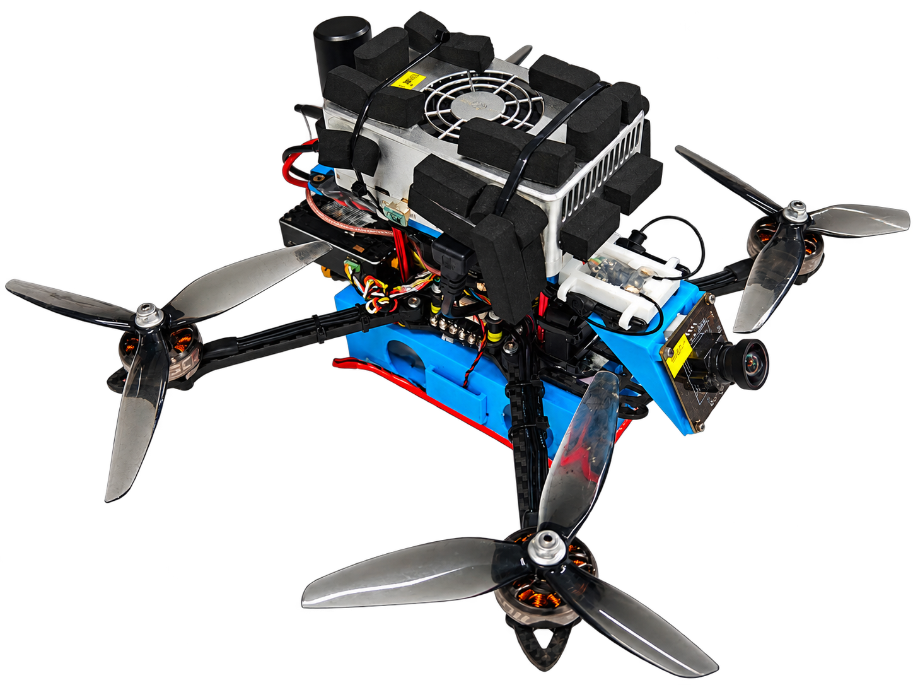 | 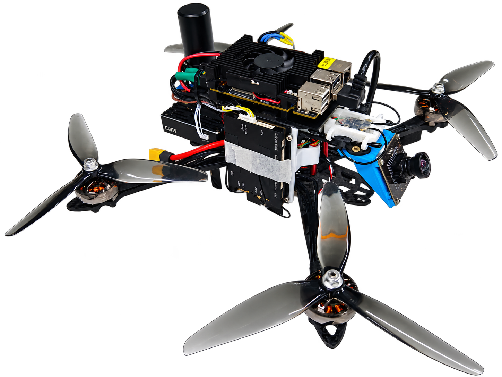 |

| Static balloon towing | Pivoting balloon towing |
| :---: | :---: |
| 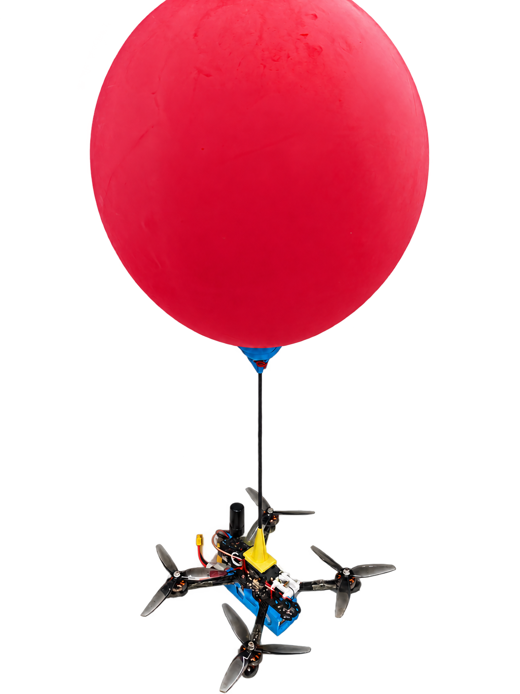 | 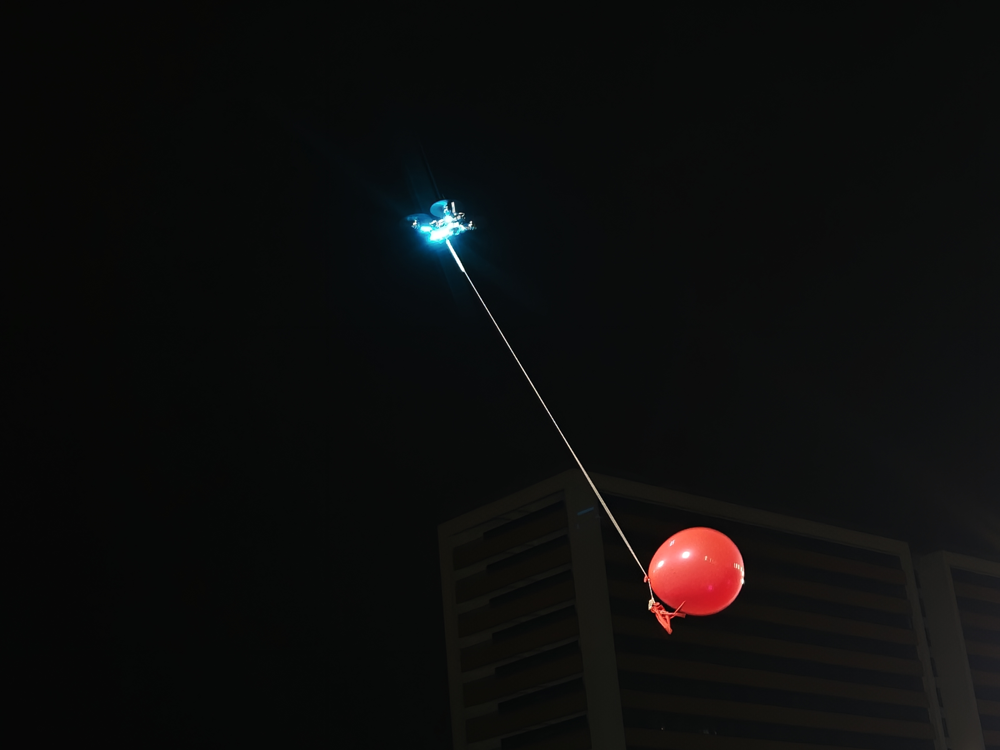 |

[Original photos and media notes](demo/real/README.md) · [ORIN NX night flight photo](demo/real/originals/holydrone_nx_darkbg.jpg)

## Flight demonstrations

| Balloon towing | Two-drone balloon experiment |
| :---: | :---: |
| <a href="demo/real/holydrone_towing.mp4">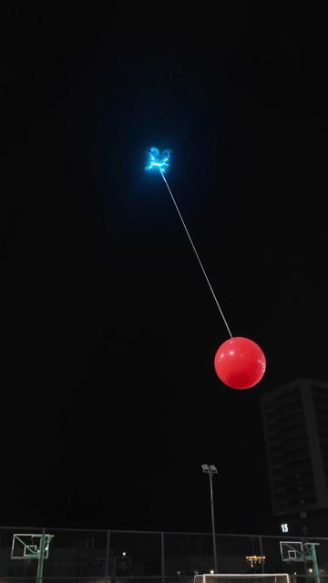</a> | <a href="demo/real/intercept_slow.mp4">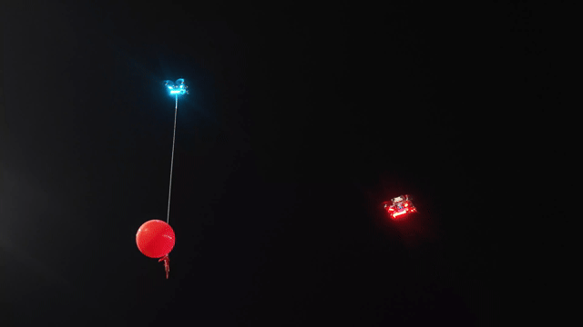</a> |
| [Watch MP4](demo/real/holydrone_towing.mp4) | [Watch MP4](demo/real/intercept_slow.mp4) |

## Variants and CAD

| Variant | Structure | Assembly |
| --- | --- | --- |
| ORIN NX | ORIN NX companion computer | [holydrone_nx_v1](Hardware/holydrone_nx_v1.SLDASM) |
| LubanCat 4 | LubanCat 4 with a six-hole mounting bracket | [holydrone_lbc4_v1](Hardware/holydrone_lbc4_v1.SLDASM) |
| Static towing | Vertical carbon rod and balloon cup; no companion computer | [holydrone_static_towing_v1](Hardware/holydrone_static_towing_v1.sldasm) |
| Pivoting towing | Hinged mechanism with ground and airborne configurations; no companion computer | [holydrone_towing_v1](Hardware/holydrone_towing_v1.SLDASM) |

<details>
<summary>CAD exploded views and towing structures</summary>

| ORIN NX | LubanCat 4 |
| :---: | :---: |
|  |  |

| Static towing | Pivoting towing |
| :---: | :---: |
| 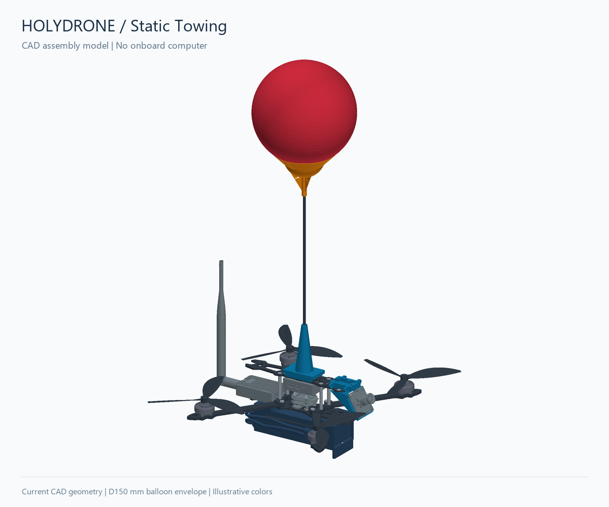 | 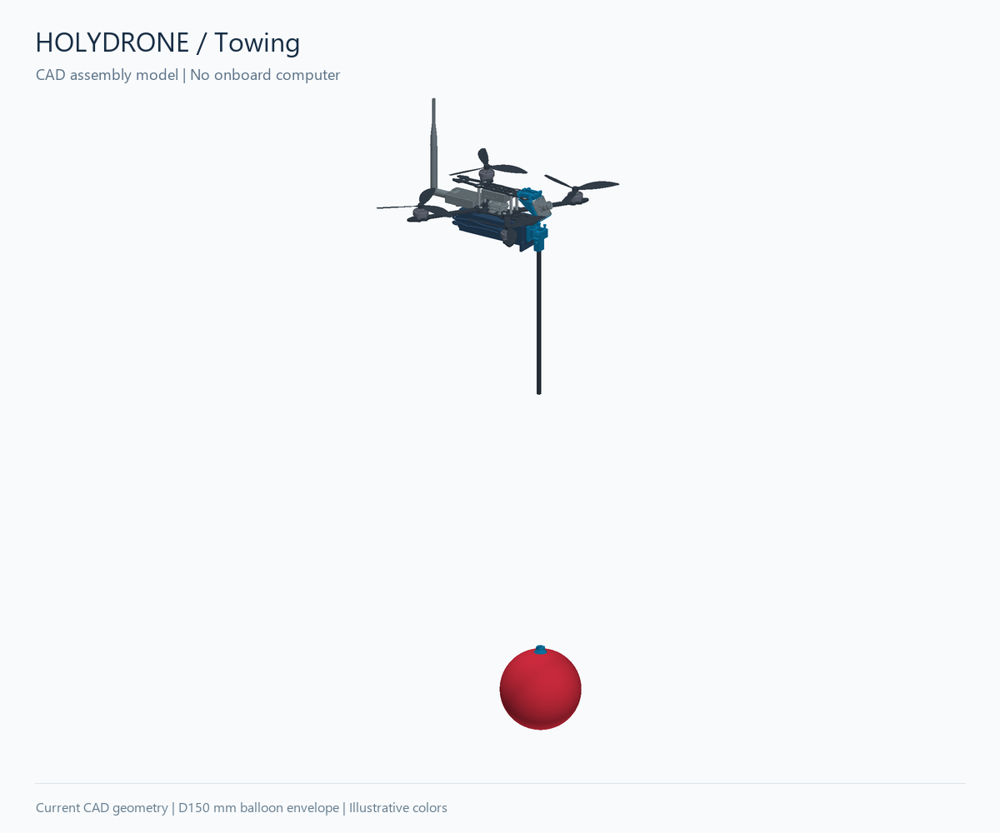 |

CAD colors are illustrative. The tether is thickened in the preview for visibility. [Rendering notes](demo/README.md)

</details>

## Getting started

Install Git LFS, then download the repository and its model files:

```bash
git lfs install
git clone https://github.com/HOLYNOTBAD/holydrone.git
cd holydrone
git lfs pull
```

Open the selected assembly in `Hardware/` with **SolidWorks 2024**. Keep the folder structure intact and check rebuild warnings and component references. Before printing, confirm the STL version and millimeter units. Before using firmware or parameters, verify the flight controller, wiring, and aircraft configuration.

## Repository guide

| Location | Contents |
| --- | --- |
| [Hardware](Hardware/) | Assemblies, module models, and frame plates |
| [Aircraft parts](Hardware/3dp4drone/) / [Experiment fixtures](Hardware/3dp4exp/) | Printable brackets, balloon mechanisms, and ground fixtures |
| [BOM notes](Hardware/BOM.md) | Variant differences and component selection notes |
| [Firmware](Firmware/) / [Params](Params/) | PX4 firmware and flight parameter snapshots |
| [demo](demo/) | Photos, videos, and CAD animations |
| [Hardware directory index](Hardware/DIRECTORIES.md) | Model and file descriptions |

Some CAD component models differ from the installed hardware; see the [BOM notes](Hardware/BOM.md). Complete companion-computer software and wiring documentation are not included.

## License

No repository-wide license has been specified. Third-party models remain subject to their original authors' licenses.

## Bill of materials

Select the companion computer and towing accessories for your variant. Verify specifications and quantities before ordering; batteries, wiring, and fasteners are not fully itemized.

| # | Component / specification | Image | Quantity | Purchase link |
| --- | --- | :---: | :---: | --- |
| 1 | Mark4 7-inch frame | 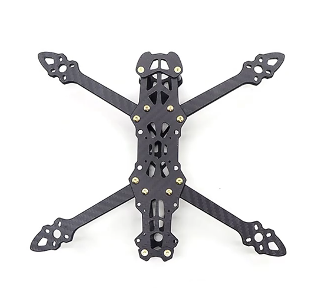 | 1 set | [Product](https://item.taobao.com/item.htm?id=678090972875&skuId=4871676933340) |
| 2 | EMAX ECO II 2807 1700KV motor | 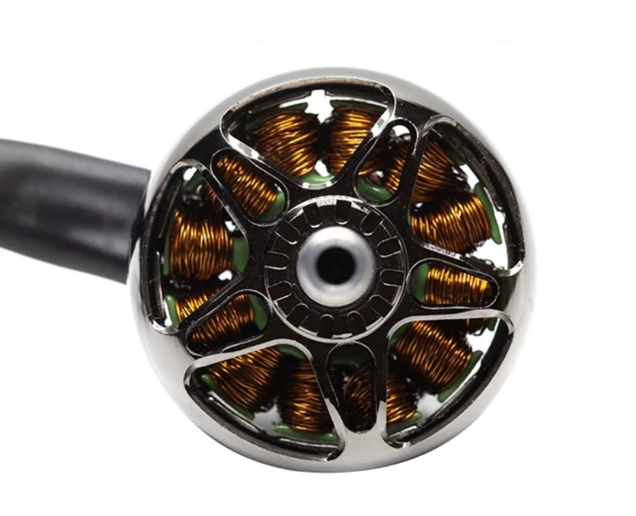 | 4 | [Product](https://item.taobao.com/item.htm?id=642731025018&skuId=5101017592191) |
| 3 | MicoAir743 V2 + 70A 32-bit 4-in-1 ESC stack | 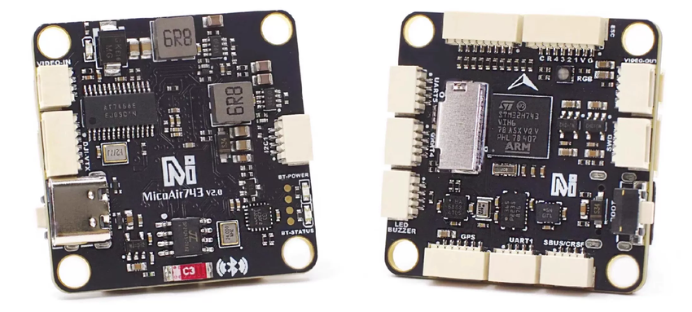 | 1 set | [Product](https://item.taobao.com/item.htm?id=949016296353&skuId=6025215071231) |
| 4 | Amov Lab Allspark2-Orin companion computer | 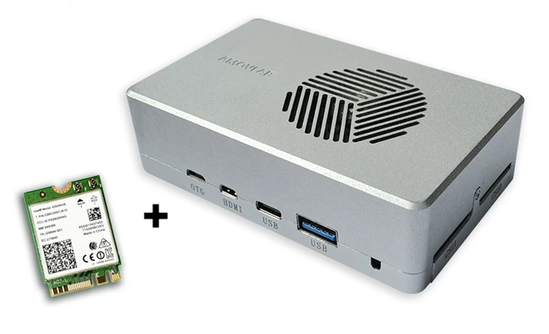 | 1 | [Product](https://item.taobao.com/item.htm?id=705748339987&skuId=5786543713974) |
| 5 | CUAV P9 telemetry radio | 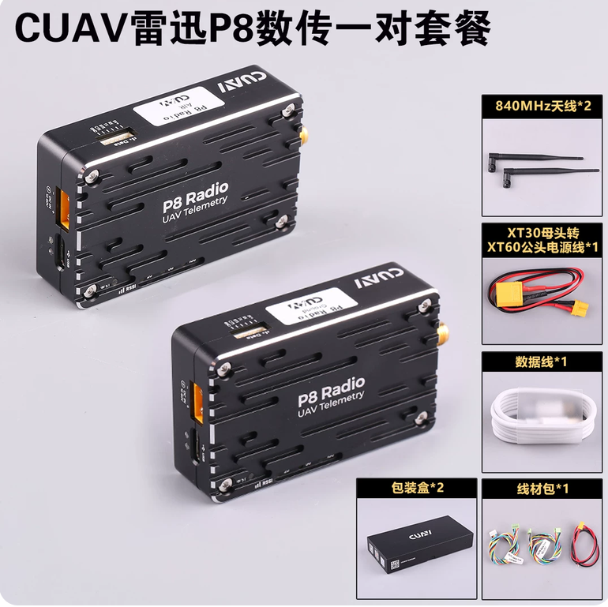 | 1 pair | [Product](https://item.taobao.com/item.htm?id=667193254604&skuId=4809453989330) |
| 6 | 2.4 GHz ELRS receiver | 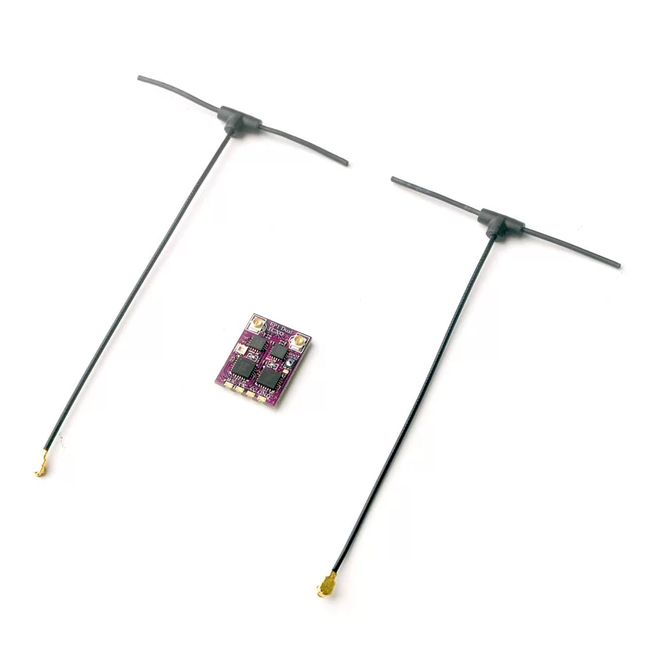 | 1 | [Product](https://item.taobao.com/item.htm?id=831092464978&skuId=6055826220853) |
| 7 | Yahboom 2 MP USB camera | 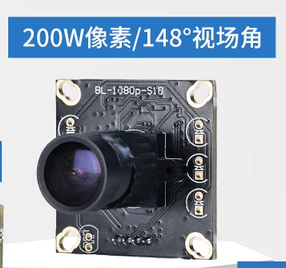 | 1 | [Product](https://detail.tmall.com/item.htm?id=775110864301&skuId=5300422684518) |
| 8 | Unidentified item | 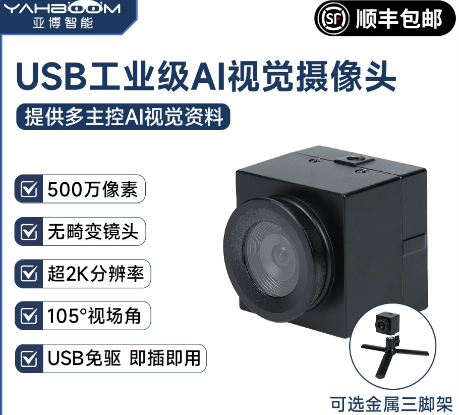 | 1 | [Source entry](https://app.notion.com/p/39c3520427fd80ab800af4c0dd67ad9f) |
| 9 | HQProp 7040 7-inch three-blade propellers | 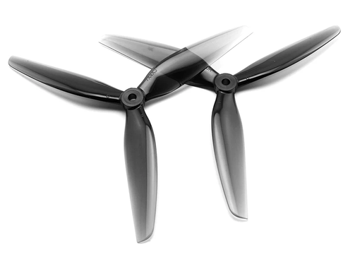 | Multiple sets | [Product](https://item.taobao.com/item.htm?id=671633881954&skuId=5010241515719) |
| 10 | 12 V DC-DC converter (NX) | 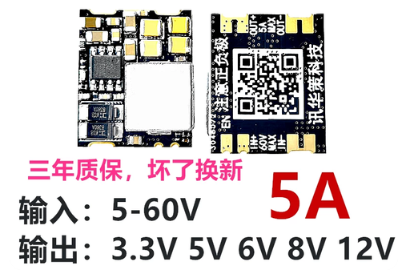 | 1 | [Product](https://item.taobao.com/item.htm?id=677122068881&skuId=6264144190644) |
| 11 | 5 V DC-DC converter |  | 1 | [Product](https://item.taobao.com/item.htm?id=677122068881&skuId=6264144190643) |
| 12 | Micro-HDMI display emulator | 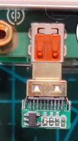 | 1 | [Product](https://item.taobao.com/item.htm?id=896020537740&skuId=5980377650344) |
| 13 | RGB LED strip + quick-connect board | — | 1 | [Product](https://item.taobao.com/item.htm?id=1039871543334&skuId=6226525563898) |
| 14 | Parachute | 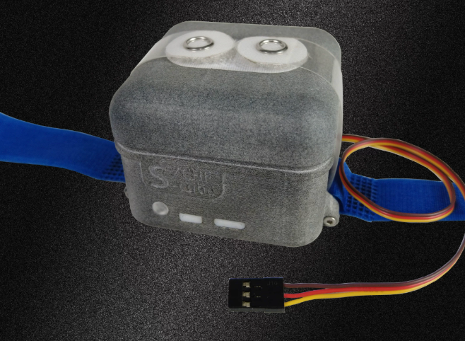 | 1 | [Product](https://item.taobao.com/item.htm?id=707712088745&skuId=4970106592804) |
| 15 | CUAV C-RTK 9Ps RTK module | 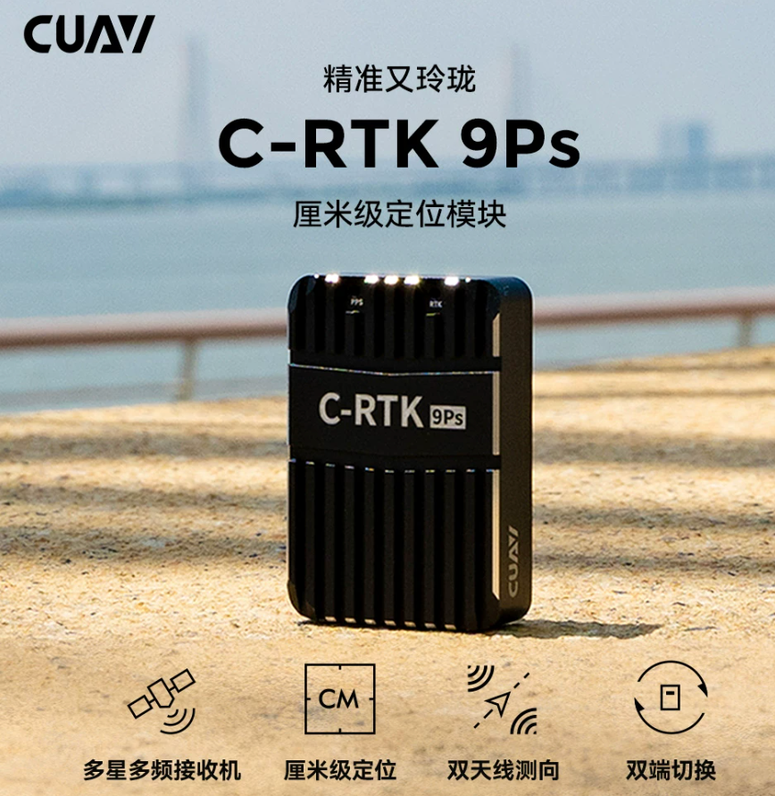 | 1 | [Product](https://item.taobao.com/item.htm?id=672313744007&skuId=4841813280367) |
