<h1 align="center">Holydrone</h1>
<p align="center"><strong>An Open 7-Inch Quadrotor Platform for Aerial Robotics Research</strong></p>

<p align="center">
  <a href="https://arxiv.org/abs/2610.34789"></a>
  <a href="LICENSE"></a>
  
  
  
</p>

<p align="center">
  <a href="#hardware-gallery">Gallery</a> ·
  <a href="#flight-demonstrations">Demonstrations</a> ·
  <a href="#variants-and-cad">CAD</a> ·
  <a href="#bill-of-materials">Bill of Materials</a> ·
  <a href="#px4-sitl-and-gazebo-classic-deployment">Simulation</a> ·
  <a href="#citation">Citation</a>
</p>

**Holydrone** is a Mark4 7-inch quadrotor research platform developed for
vision-based interception and low-altitude safety experiments. Four variants
support NVIDIA Jetson Orin NX and LubanCat 4 companion computers, static balloon
towing, and pivoting balloon towing. This repository provides CAD assemblies,
3D-printable parts, PX4 firmware, parameter snapshots, and hardware demonstrations.

## Project ecosystem

| Resource | Description |
| :--- | :--- |
| [Paper · ISB-NMPC](https://arxiv.org/abs/2610.34789) | Interception-oriented spherical-bearing NMPC and delay-compensated visual estimation |
| [Algorithm · ISB-NMPC](https://github.com/HOLYNOTBAD/ISB-NMPC) | Perception, estimation, control, and experiment workflows used with this platform |
| [ROS integration · holydrone_ros](https://github.com/HOLYNOTBAD/holydrone_ros) | Gazebo models, Baylands terrain, PX4 SITL, MAVROS launch files, and camera utilities |
| [Rate-loop tuning · holydrone_autotune](https://github.com/HOLYNOTBAD/holydrone_autotune) | ROS 1 and MAVROS workflow for testing predefined PX4 PID candidates with repeatable body-rate pulses and offline response metrics |
| [Calibration · holydrone_cali](https://github.com/HOLYNOTBAD/holydrone_cali) | Calibration tools for the Holydrone platform (repository under development) |
| [System identification · holydrone_identification](https://github.com/HOLYNOTBAD/holydrone_identification) | ROS 1 workflows for first-, second-, and third-order closed-loop response identification and Gazebo physical-parameter estimation |

> [!NOTE]
> We hope this platform supports further research and development toward a
> peaceful and safe low-altitude environment. Feedback and contributions are
> welcome; contact [hongli@buaa.edu.cn](mailto:hongli@buaa.edu.cn).
>
> If this repository contributes to your work, please cite
> [our paper](#citation) and consider starring the related repositories.

Contributors include: [Li Hong](https://github.com/HOLYNOTBAD),
[Linkai Liu](https://github.com/InNoPuzzLevaTion), Dingchen Zeng, Xiangyu Ren,
[Chunjiang Wu](https://github.com/wuchunjiang0129), Yuchen Xiao, Yuehui He,
Yujun Zhang, Shuli Lv, and Chen Min.

## Hardware gallery

| ORIN NX | LubanCat 4 |
| :---: | :---: |
| 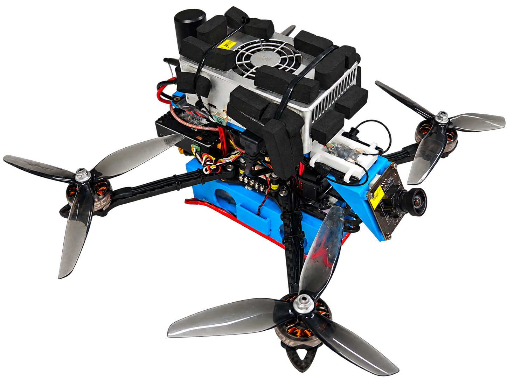 | 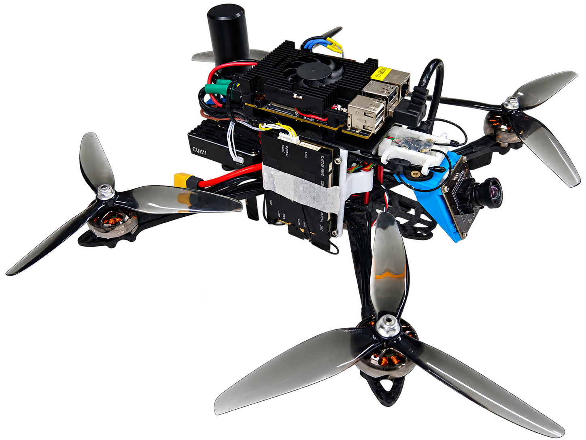 |

| Static balloon towing | Pivoting balloon towing |
| :---: | :---: |
| 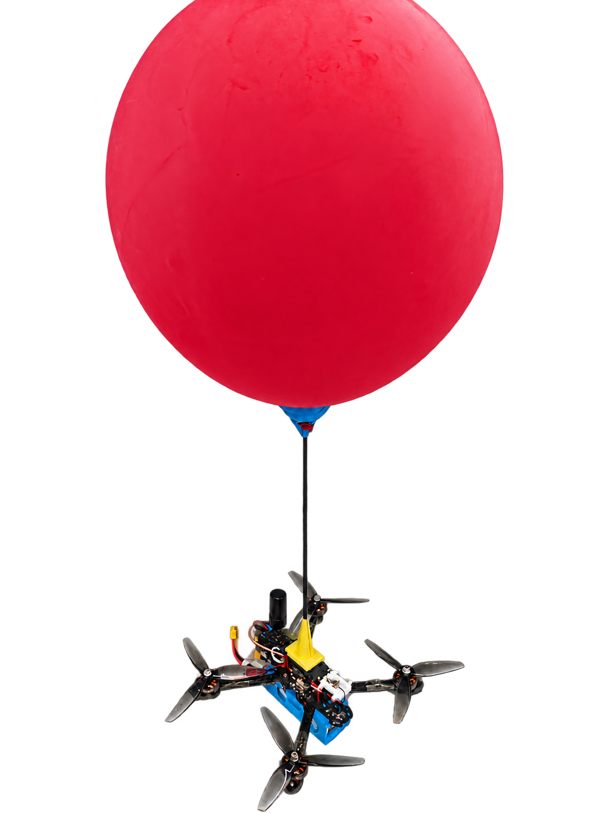 | 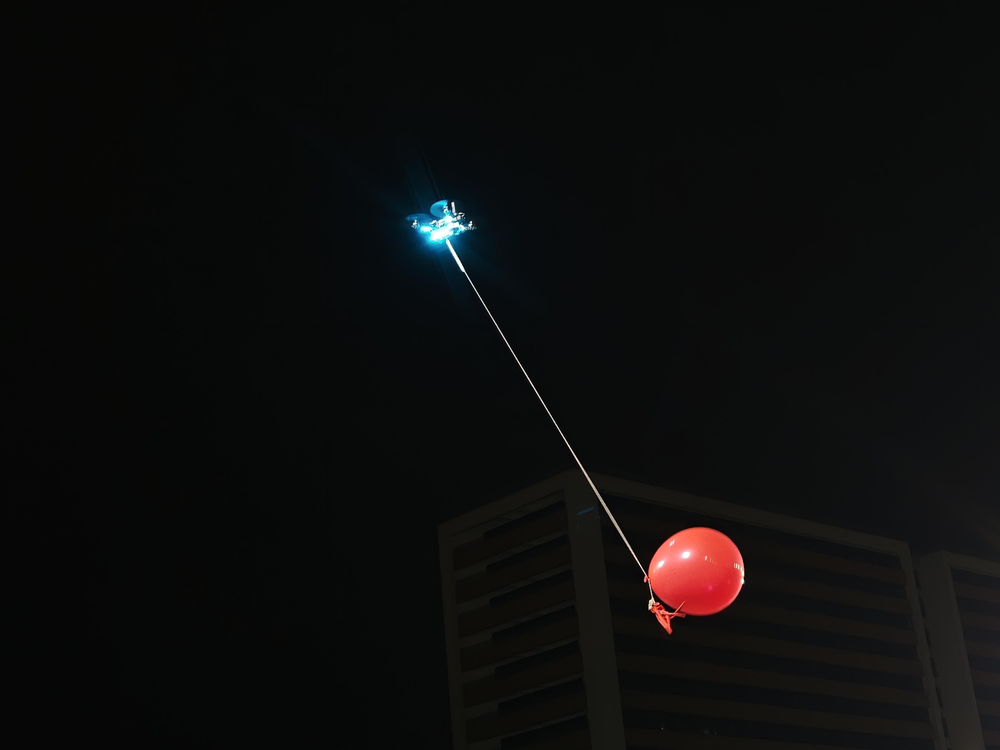 |

[Original photos and media notes](demo/real/README.md) · [ORIN NX night flight photo](demo/real/originals/holydrone_nx_darkbg.jpg)

## Flight demonstrations

| Balloon towing | Two-drone balloon experiment |
| :---: | :---: |
| <a href="demo/real/holydrone_towing.mp4">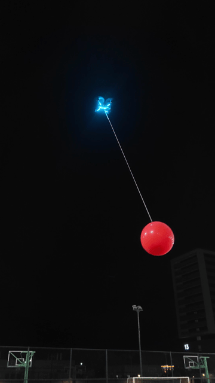</a> | <a href="demo/real/intercept_slow.mp4">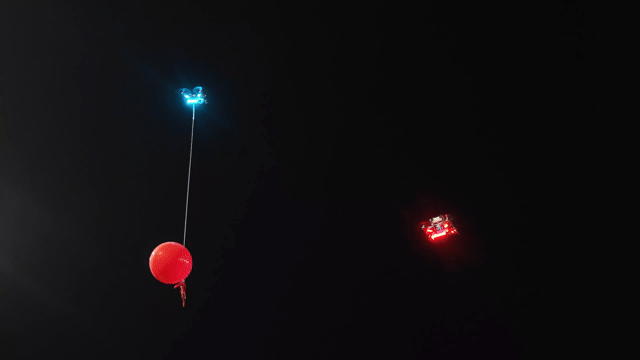</a> |
| [Watch MP4](demo/real/holydrone_towing.mp4) | [Watch MP4](demo/real/intercept_slow.mp4) |

## Variants and CAD

| Variant | Structure | Assembly |
| --- | --- | --- |
| ORIN NX | ORIN NX companion computer | [holydrone_nx_v1](Hardware/holydrone_nx_v1.SLDASM) |
| LubanCat 4 | LubanCat 4 with a six-hole mounting bracket | [holydrone_lbc4_v1](Hardware/holydrone_lbc4_v1.SLDASM) |
| Static towing | Vertical carbon rod and balloon cup; no companion computer | [holydrone_static_towing_v1](Hardware/holydrone_static_towing_v1.sldasm) |
| Pivoting towing | Hinged mechanism with ground and airborne configurations; no companion computer | [holydrone_towing_v1](Hardware/holydrone_towing_v1.SLDASM) |

<details>
<summary>CAD exploded views and towing structures</summary>

| ORIN NX | LubanCat 4 |
| :---: | :---: |
|  | 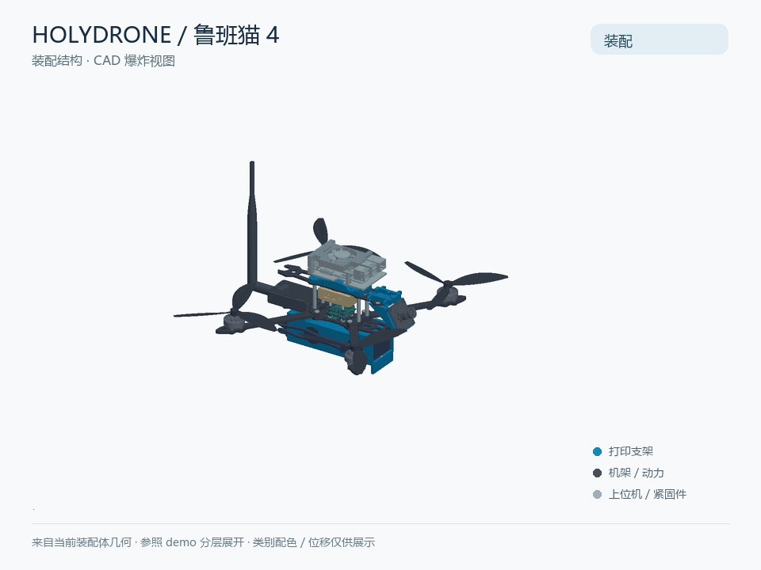 |

| Static towing | Pivoting towing |
| :---: | :---: |
| 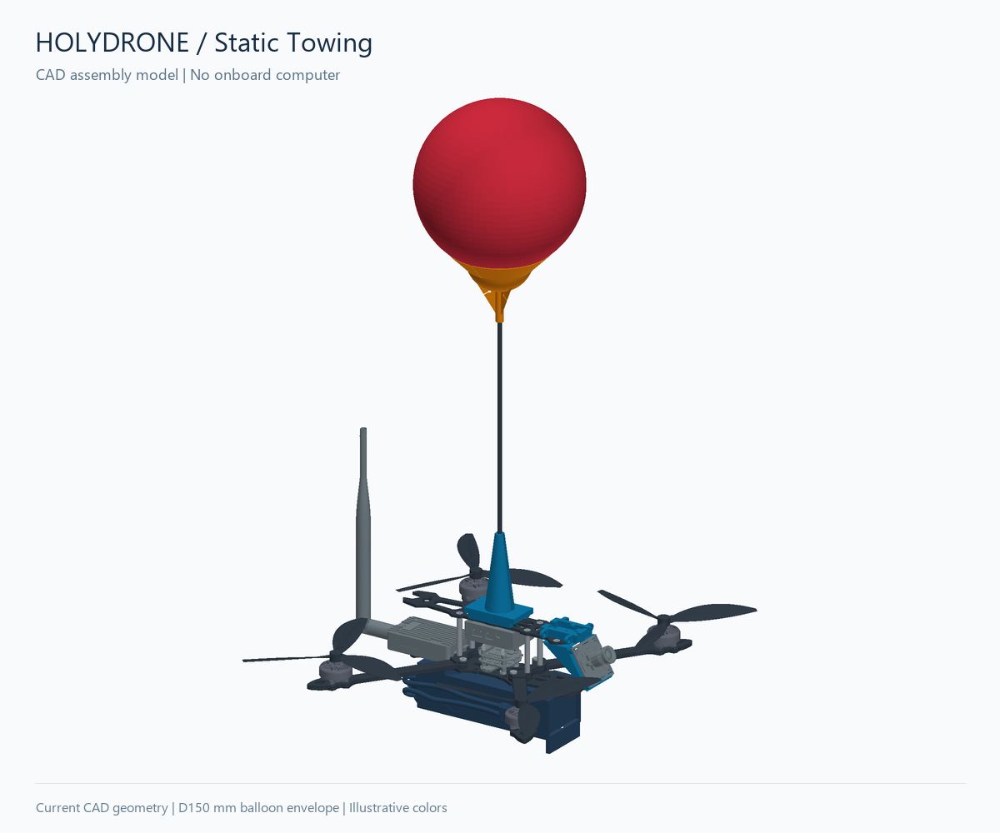 | 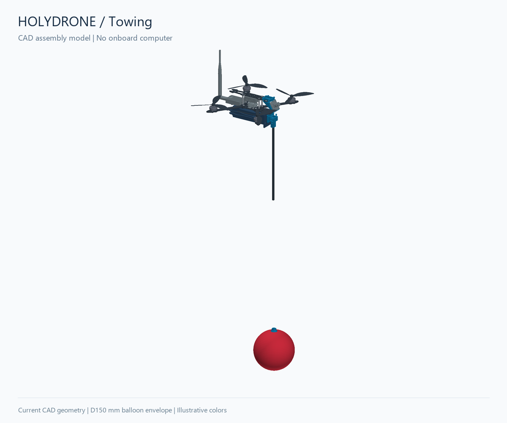 |

CAD colors are illustrative. The tether is thickened in the preview for visibility. [Rendering notes](demo/README.md)

</details>

## Getting started

Install Git LFS, then download the repository and its model files:

```bash
git lfs install
git clone https://github.com/HOLYNOTBAD/holydrone.git
cd holydrone
git lfs pull
```

Open the selected assembly in `Hardware/` with **SolidWorks 2024**. Keep the folder structure intact and check rebuild warnings and component references. Before printing, confirm the STL version and millimeter units. Before using firmware or parameters, verify the flight controller, wiring, and aircraft configuration.

## Repository guide

| Location | Contents |
| --- | --- |
| [Hardware](Hardware/) | Assemblies, module models, and frame plates |
| [Aircraft parts](Hardware/3dp4drone/) / [Experiment fixtures](Hardware/3dp4exp/) | Printable brackets, balloon mechanisms, and ground fixtures |
| [BOM notes](Hardware/BOM.md) | Variant differences and component selection notes |
| [Firmware](Firmware/) / [Params](Params/) | PX4 firmware and flight parameter snapshots |
| [Simulation](Simulation/holydrone_sim/) | ROS package, Gazebo Classic model and PX4 SITL overlay |
| [demo](demo/) | Photos, videos, and CAD animations |
| [Hardware directory index](Hardware/DIRECTORIES.md) | Model and file descriptions |

Some CAD component models differ from the installed hardware; see the [BOM notes](Hardware/BOM.md). Complete companion-computer software and wiring documentation are not included.

## License

This repository is released under the [GNU General Public License v3.0](LICENSE).
Third-party assets remain subject to their respective licenses and attribution
requirements; see the notices supplied alongside those assets.

## Bill of materials

Select the companion computer and towing accessories for your variant. Verify specifications and quantities before ordering; batteries, wiring, and fasteners are not fully itemized.

| # | Component / specification | Image | Quantity | Purchase link |
| --- | --- | :---: | :---: | --- |
| 1 | Mark4 7-inch frame | 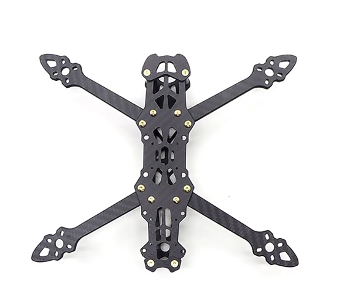 | 1 set | [Product](https://item.taobao.com/item.htm?id=678090972875&skuId=4871676933340) |
| 2 | EMAX ECO II 2807 1700KV motor | 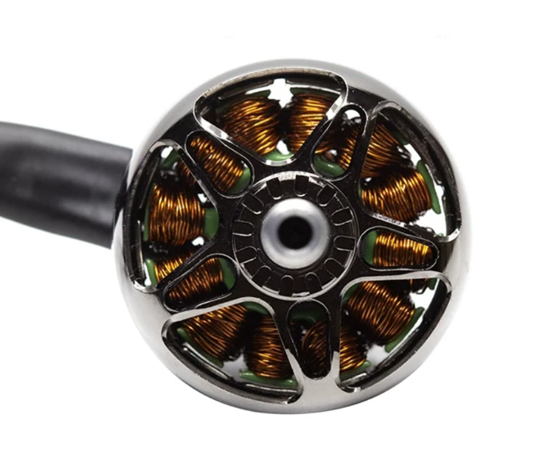 | 4 | [Product](https://item.taobao.com/item.htm?id=642731025018&skuId=5101017592191) |
| 3 | MicoAir743 V2 + 70A 32-bit 4-in-1 ESC stack | 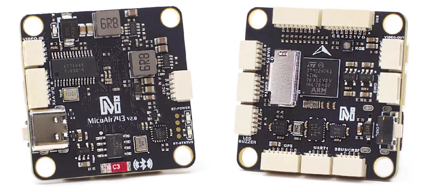 | 1 set | [Product](https://item.taobao.com/item.htm?id=949016296353&skuId=6025215071231) |
| 4 | Amov Lab Allspark2-Orin companion computer | 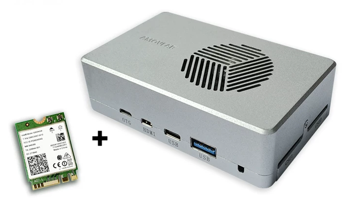 | 1 | [Product](https://item.taobao.com/item.htm?id=705748339987&skuId=5786543713974) |
| 5 | CUAV P9 telemetry radio | 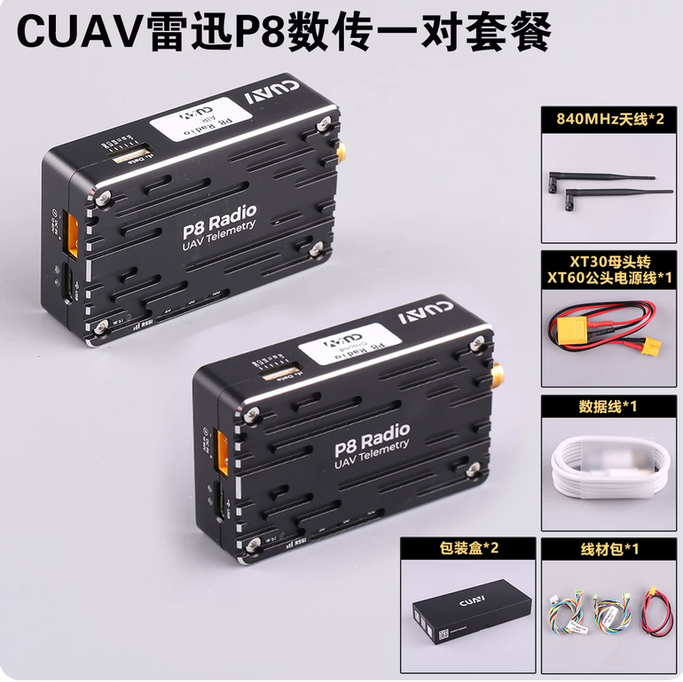 | 1 pair | [Product](https://item.taobao.com/item.htm?id=667193254604&skuId=4809453989330) |
| 6 | 2.4 GHz ELRS receiver | 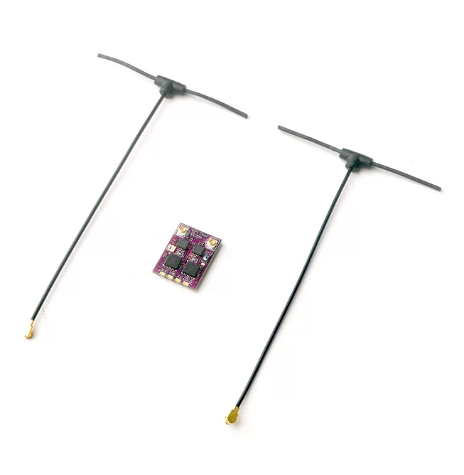 | 1 | [Product](https://item.taobao.com/item.htm?id=831092464978&skuId=6055826220853) |
| 7 | Yahboom 2 MP USB camera | 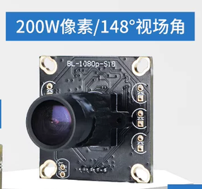 | 1 | [Product](https://detail.tmall.com/item.htm?id=775110864301&skuId=5300422684518) |
| 8 | Unidentified item | 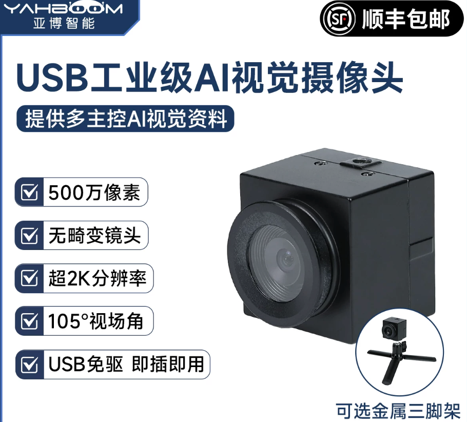 | 1 | [Source entry](https://app.notion.com/p/39c3520427fd80ab800af4c0dd67ad9f) |
| 9 | HQProp 7040 7-inch three-blade propellers | 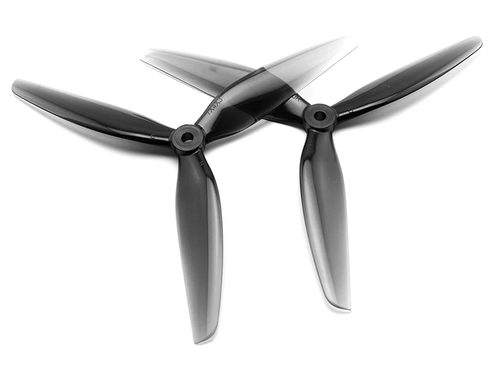 | Multiple sets | [Product](https://item.taobao.com/item.htm?id=671633881954&skuId=5010241515719) |
| 10 | 12 V DC-DC converter (NX) | 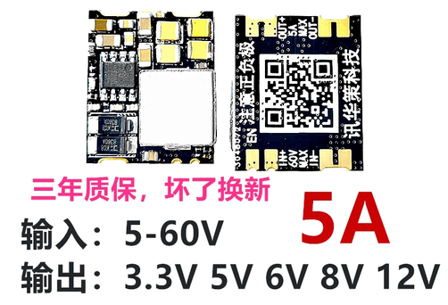 | 1 | [Product](https://item.taobao.com/item.htm?id=677122068881&skuId=6264144190644) |
| 11 | 5 V DC-DC converter |  | 1 | [Product](https://item.taobao.com/item.htm?id=677122068881&skuId=6264144190643) |
| 12 | Micro-HDMI display emulator | 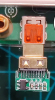 | 1 | [Product](https://item.taobao.com/item.htm?id=896020537740&skuId=5980377650344) |
| 13 | RGB LED strip + quick-connect board | — | 1 | [Product](https://item.taobao.com/item.htm?id=1039871543334&skuId=6226525563898) |
| 14 | Parachute | 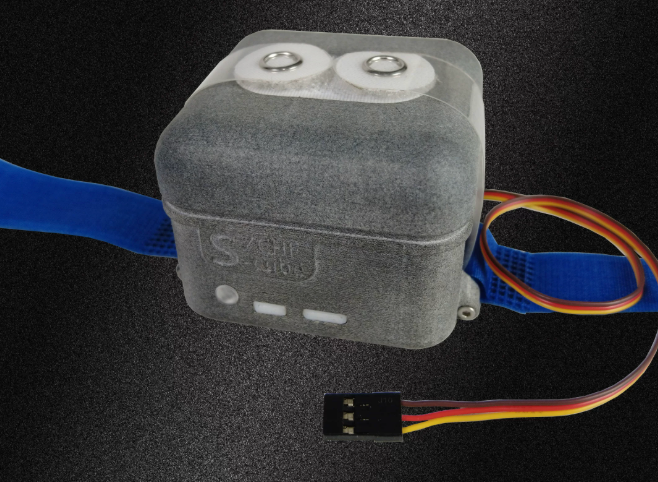 | 1 | [Product](https://item.taobao.com/item.htm?id=707712088745&skuId=4970106592804) |
| 15 | CUAV C-RTK 9Ps RTK module | 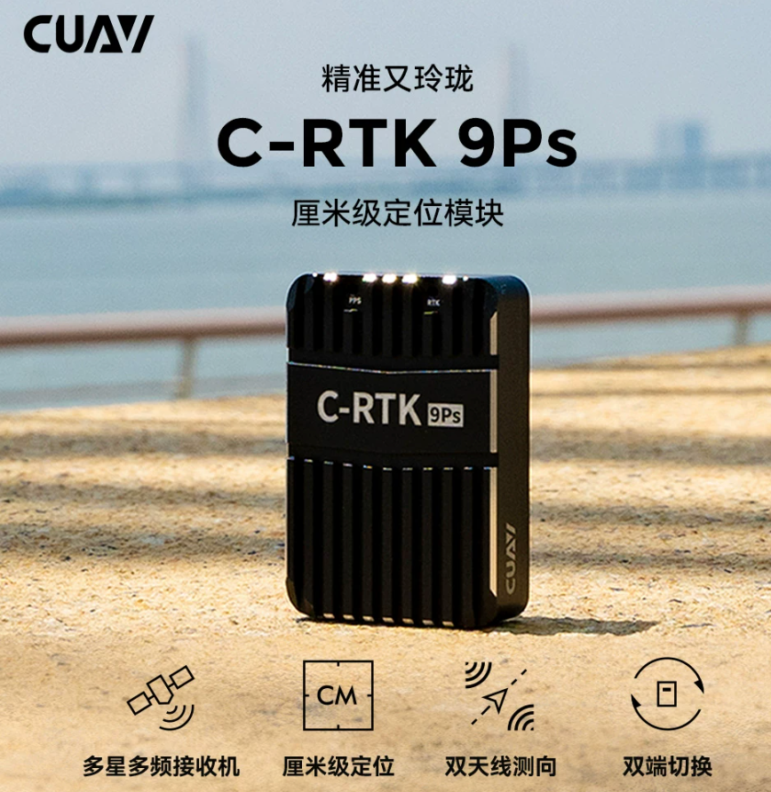 | 1 | [Product](https://item.taobao.com/item.htm?id=672313744007&skuId=4841813280367) |

To everyone who has helped along the way: thank you for your time, patience, and willingness to work through the challenges together. This project would not be where it is today without you.

## PX4 SITL and Gazebo Classic deployment

The ROS 1 package [`Simulation/holydrone_sim`](Simulation/holydrone_sim/) contains
the Holydrone SDF, meshes, GPS, lidar, FPV camera, optional visualization tools,
controller profiles, and a backup of the custom PX4 `22000` airframe. The
validated environment is Ubuntu 20.04, ROS Noetic, Gazebo Classic 11 and
PX4-Autopilot `v1.16.2` (`54f0455ffcd755534539a7cf33a09a20bf71d29d`).

### 1. Install ROS and clone PX4

Install ROS Noetic with `gazebo_ros`, then prepare the pinned PX4 source:

```bash
sudo apt update
sudo apt install git git-lfs python3-rosdep ros-noetic-desktop-full \
  ros-noetic-gazebo-ros-pkgs ros-noetic-mavros ros-noetic-mavros-extras

cd ~
git clone --recursive --branch v1.16.2 \
  https://github.com/PX4/PX4-Autopilot.git
cd PX4-Autopilot
bash Tools/setup/ubuntu.sh
```

Open a new terminal after the PX4 dependency installer finishes.

### 2. Build the ROS package

```bash
mkdir -p ~/catkin_ws/src
ln -s ~/holydrone/Simulation/holydrone_sim ~/catkin_ws/src/holydrone_sim
cd ~/catkin_ws
source /opt/ros/noetic/setup.bash
rosdep install --from-paths src --ignore-src -r -y
catkin_make
source devel/setup.bash
```

### 3. Install the PX4 airframe and build SITL plugins

The installer copies the backed-up airframe into PX4, registers it in the PX4
ROMFS build, and builds PX4 plus the Gazebo Classic plugins:

```bash
export PX4_DIR=~/PX4-Autopilot
rosrun holydrone_sim install_px4_overlay.sh
rosrun holydrone_sim check_install.sh
```

The installer is idempotent. Before editing `CMakeLists.txt` for the first time,
it saves `CMakeLists.txt.pre-holydrone-sim.bak` beside the original file.

### 4. Start Gazebo and make Holydrone take off

Run the SITL launcher from a terminal with the catkin workspace sourced:

```bash
cd ~/catkin_ws
source /opt/ros/noetic/setup.bash
source devel/setup.bash
export PX4_DIR=~/PX4-Autopilot

GAZEBO_GUI=1 PX4_RESET_PARAMS=1 AUTO_TAKEOFF=1 \
  rosrun holydrone_sim run_sitl.sh
```

Gazebo starts the bundled empty world, spawns `holydrone` at ground clearance,
starts PX4 with `PX4_SYS_AUTOSTART=22000`, arms after the estimator settles, and
sends the PX4 takeoff command. Set `AUTO_TAKEOFF=0` to keep the vehicle on the
ground for manual QGroundControl/MAVROS operation. Press `Ctrl-C` in the launcher
terminal to stop the PX4 daemon, Gazebo processes, and the private ROS master.

## Citation

If you use Holydrone or its accompanying software in academic work, please cite:

```bibtex
@article{hong2026isbnmpc,
  title={ISB-NMPC: Interception-Oriented Spherical-Bearing Nonlinear Model Predictive Control for Quadrotors},
  author={Hong, Li and Liu, Linkai and Ren, Xiangyu and Lv, Shuli and Min, Chen and Wu, Chunjiang and Zhang, Yujun and Zeng, Dingchen and Quan, Quan},
  journal={arXiv preprint arXiv:2610.34789},
  year={2026},
  doi={10.48550/arXiv.2610.34789},
  url={https://arxiv.org/abs/2610.34789}
}
```
